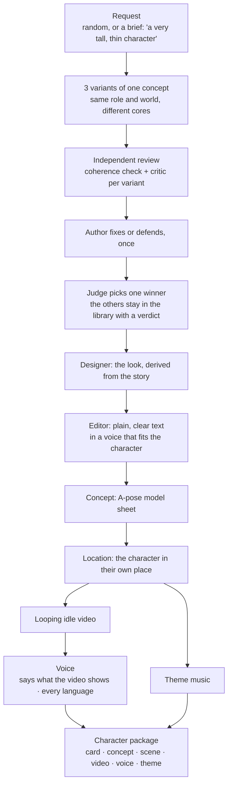

# character-forge-mcp

[](https://github.com/gdhub-io/character-forge-mcp/actions/workflows/ci.yml)
[](https://www.npmjs.com/package/character-forge-mcp)
[](LICENSE)

An open-source [MCP](https://modelcontextprotocol.io) server for creating vivid, story-ready characters for film, games, animation, advertising, books and comics.

Connect it to any MCP-capable chat (Claude Code, Claude Desktop, Cursor and others) and ask for a character. You get a **character package**:

- **Character card**: goals, audience identification, psychological profile, description, fears, archetype and quirks, backstory and world, traits, and the character arc. It is saved as `card.json` and a readable `card.md`.
- **Look derived from the story**: shape language, silhouette, how perfect or flawed they are, a signature item (their attribute), marks with origins, movement, outfit and palette with meanings. An independent designer derives it from the finished story and cuts anything that doesn't show a part of it.
- **A-pose concept sheet**: a front/back model sheet in a production A-pose, ready to hand to a 3D or animation artist. It is saved as `assets/concept.png`, and the card is re-rendered to include it.

**Random does not mean a pile of random traits.** Every character grows from one *core*: a **wound** teaches them a **lie**. The lie breeds a **fear**, which they protect with a **defense** (their worst trait). The same wound forged a **gift** (their best trait). Their arc is learning the **truth**. Each roll picks one curated, coherent core, then adds surprising *sparks* (occupation, world, archetype, visible mark) that the model has to make serve the core. You can't predict who you will get, but every part of the card hangs together.

### How a character is made



The winner gets its concept as part of the tournament. Everything after it is generated **only on request**, one step at a time, and every step is built from the card: the location from the character's key places and idle pose, the voice from their history and speech, the theme from their wound and dramatic question. The video comes after the location, and the voice after the video, because the voice is their inner monologue, the thoughts in their head in the moment the video shows; the music only needs the location.

**Already have a concept?** Give a brief and the image. What the picture shows (build, face, outfit, items, palette) becomes part of the brief, every variant's story explains it, the designer describes exactly that look, and the image becomes the winner's concept instead of a new one being generated. It's the same `character_create` call, with `concept` set.

### The variant tournament

By default every request produces **3 variants of the same concept**. If you ask for a fisherman, all three are fishermen in the same world, but different people with different cores. Then they compete:

1. **Author** writes all three as full cards.
2. **Coherence reviewer** (an independent agent per variant) checks that everything traces back to the core.
3. **Critic** (an independent agent per variant) argues why the variant should *not* ship, quoting the card and scoring it against a rubric.
4. **Author** fixes or rebuts each critique, once.
5. **Judge** compares the revised variants and picks one winner.

6. **Designer** (an independent agent) derives the winner's look from its story.
7. **Editor** (an independent agent) rewrites the winner's text so a stranger understands every field on the first read.

Only the winner gets an A-pose concept. The losers stay in the library with their verdict.

### Generation prompts (on request)

Ask for a prompt and you get exactly that one, written from the card:

- **concept**: an A-pose model sheet
- **illustration**: a key-art scene from the character's story, in a location and with an event happening
- **voice**: a voice-design description and an audition script for TTS voice-design tools
- **video**: a 5–10 s Seedance-style clip that shows the character in action
- **song**: a Suno style line and lyrics that tell the character's arc
- **theme**: an instrumental leitmotif (about 30 s, loops) built from the wound, the paradox and the dramatic question, as an ElevenLabs Music composition plan

Prompts are saved to `<character>/prompts/<kind>.md`. Writing a prompt never calls a generator; the concept, scene, video, voice and theme tools do, each only when asked.

There are two modes:

- **Random**: optionally fix the role ("a fisherman"), medium or genre. Everything else is rolled.
- **From a brief**: you describe what matters ("a 60-year-old ex-boxer for a coffee ad, warm but stubborn"). Every variant keeps all of it and invents the rest.

Characters are always written in English.

## The method

For diagrams of how a character is built (the core chain, what shapes them, their path, how the audience gets to know them, and the tournament), see [docs/character-anatomy.md](docs/character-anatomy.md).

The card opens with the **core** (wound, lie, truth, central paradox, dramatic question) and then follows a 9-section character-development method inspired by Sherri Sheridan's *Developing Digital Short Films* and Michael Dougan's "one best / one worst / three other traits" formula (see [Credits](#credits)):

1. **Goals**: *want* (external, can change) vs. *need* (inner, carries the theme), motivation, goals that exclude each other, and the goal's climax
2. **Identification**: why the audience bonds with the character: flaws, a superpower balanced by a vulnerability, a sympathy hook…
3. **Psychology**: passive / reactive / active states, 3 lines of inner monologue, insecurity, triggers, childhood, and a device for showing the inner state on screen
4. **Description**: a name with meaning, the character's look, 3 formative life events, speech, sociology, dreams
5. **Fears**: conscious and unconscious fears, the mask, and how the character overcomes them
6. **Universal + unique**: an archetype with a twist and at least 5 filmable quirks
7. **Backstory & world**: who rules the world, what is worth dying for, plus secondary characters who reveal the hero's contradictions
8. **Traits**: energy, temperament, one best trait, one worst trait, three others, and typical reactions
9. **Destiny**: the void in the ordinary world, the threshold, the ordeal, the transformation

The schema checks that the card is complete: at least 3 identification methods, exactly 3 inner-monologue lines, exactly 3 life events, at least 5 quirks, and so on. When the model leaves something out, the server returns the exact field paths to fix.

## Install

Requires Node.js 20+. Nothing to clone or build: the server is published on npm.

### Claude Code (plugin, recommended)

The plugin bundles the MCP server, the skills (`forge-character`, `design-look`, `concept-art`, `character-prompts`, `translate-character`) and the agents (`character-coherence`, `character-critic`, `character-judge`, `character-designer`, `character-editor`). With the plugin, each reviewer runs as a separate agent with fresh context.

```
/plugin marketplace add gdhub-io/character-forge-mcp
/plugin install character-forge@character-forge
```

Claude Code asks for the optional fal.ai key when you install the plugin and keeps it in your system's secure storage. Leave it empty to make characters, cards and prompts only; add it later in `/plugin`.

### Claude Code (MCP only)

```bash
claude mcp add character-forge -e CHARACTER_FORGE_DIR=~/character-forge -e FAL_KEY=... -- npx -y character-forge-mcp
```

Without the plugin there are no separate reviewer agents. The model plays each role in a separate pass instead, which is weaker but still works.

### Claude Desktop / Cursor / any MCP client

```json
{
  "mcpServers": {
    "character-forge": {
      "command": "npx",
      "args": ["-y", "character-forge-mcp"],
      "env": {
        "CHARACTER_FORGE_DIR": "/Users/you/character-forge",
        "FAL_KEY": "..."
      }
    }
  }
}
```

Characters are saved to `CHARACTER_FORGE_DIR` (default `~/character-forge`), one folder per character.

## Use

In the chat:

> Make me a random character for a noir film.

> Character from a brief: a teenage beekeeper in a cyberpunk megacity, the hero of a cozy mobile game. She must be left-handed and afraid of crowds.

Clients that support MCP prompts also list `random_character` and `character_from_brief`.

### Tools

| Tool | What it does |
|---|---|
| `character_method` | Returns the method, the card rules and the tournament protocol |
| `character_create` | Starts a character from nothing, a brief, a concept image, or both: rolls 3 competing variants of one concept (coherent cores plus sparks) and says how to use the brief and the image |
| `character_check` | Coherence check: red flags (generic filler, repeats, want = need) plus questions built from the card's own content |
| `character_role` | Instructions and rubric for a role: `coherence`, `critic`, `judge`, `author`, `designer` |
| `character_save` | Validates the full card and saves JSON + Markdown; returns the `id` |
| `character_concept` | Builds the A-pose prompt and generates `concept.png` (`views`, `strength`, `figure`, `mode`, `pose_image`, `seed`, `dry_run`) |
| `character_prompt` | On request: the rules and card material for one generation prompt (`concept`, `illustration`, `voice`, `video`, `song`, `theme`) |
| `character_prompt_save` | Saves a written prompt as `prompts/<kind>.md` |
| `character_list` | Lists saved characters, with variant group and verdict (`group` filter) |
| `character_get` | Returns a card as markdown or JSON (edit it, then save again with `overwrite`) |

## Concept sheets (A-pose)

Concepts are generated on [fal.ai](https://fal.ai), about $0.01 per sheet. Set `FAL_KEY` in the environment, or in a gitignored `.env` in the working directory.

How the pose is held: character-forge draws a faceless figure in an A-pose, front and back, the way a concept artist blocks in an idea. The figure is built from the card's `look.body` (the character's own proportions and asymmetries) and painted in the zone colours from `look.blocking` (hair, skin, top, bottom, left and right footwear). It then repaints that block-in into the character with `fal-ai/z-image/turbo/image-to-image`, so both the pose and the colours carry through.

- `strength` (default 0.85) sets how much of the mannequin is repainted. Z-Image runs 8 steps, so strength works in steps of 1/8:
  - 0.75 keeps the pose but greys the colours;
  - 0.85 keeps the pose and gets most of the colours;
  - 0.9 or more frees the colours but loses the pose.
- `figure` picks the drawing:
  - `blocking-lit` (default when the card has `look.blocking`): zone colours with volume;
  - `blocking`: flat 2D colour patches;
  - `shaded`: a grey 3D mannequin (default without `blocking`; greys the colours);
  - `flat` or `mask`.
- `mode` can switch to ControlNet conditions (`pose`, `depth`, `canny` via `fal-ai/z-image/turbo/controlnet`). In our tests they barely held the pose.
- `pose_image` (CLI: `--pose`) puts the character in the pose of any picture. The result is saved as `concept-pose.png`.
- `seed` reproduces a result.
- `style`: every concept uses one house style (stylized 3D), so the whole library reads as one project. To see the same character in another look, pass `style`, either `card` (the designer's suggestion in `look.art_style`) or any style text. The result is saved as `concept-<style>.png` next to the main sheet.
- `mode: "gpt"` sends the block-in to `openai/gpt-image-2.6/flare/edit` as a reference, at low quality (about $0.02 per sheet). It is the most consistent between front and back: sides, accessories and mismatched boots all stay put.

The `concept-art` skill wraps all this and checks each result against the card's look. Without `FAL_KEY`, `character_concept` returns a ready-made prompt.

## CLI

The same binary is also a CLI for testing and scripting:

```bash
node dist/index.js roll --seed 42 --medium film
node dist/index.js roll --variants 3 --anchor fisherman
node dist/index.js validate examples/marta-vell.json
node dist/index.js check examples/marta-vell.json
node dist/index.js save examples/marta-vell.json
node dist/index.js prompt marta-vell --views front-side-back
node dist/index.js media marta-vell --kind song      # brief for one generation prompt
node dist/index.js concept marta-vell --style "anime cel-shaded"
node dist/index.js list
```

With no arguments it starts the MCP server on stdio.

To poke at the server interactively, run `npm run inspect` (MCP Inspector).

## Development

Want to help? Read [CONTRIBUTING.md](CONTRIBUTING.md): every change goes through a pull request, and releases are automatic.

```bash
npm run build
npm test          # unit tests + an end-to-end MCP client/server test
```

The project layout:

- `src/methodology.ts`: the method as data (arc goals, flaws, fears, archetypes, trait lists…)
- `src/engine.ts`: curated core chains (wound → lie → fear → defense/gift → truth), occupations, visible marks. PRs that extend these are welcome.
- `src/random.ts`: seeded rolls and variant sets
- `src/check.ts`: coherence red flags and questions
- `src/tournament.ts`: rubric and role instructions (coherence, critic, judge, author, designer)
- `src/media.ts`: rules and card material for generation prompts (illustration, voice, video, song, theme)
- `src/schema.ts`: the card schema (zod)
- `src/render.ts`: Markdown card rendering
- `src/concept.ts`: the A-pose prompt and the concept pipeline
- `src/store.ts`: the character library on disk
- `src/tools/`: one file per MCP tool
- `src/prompts/`: MCP prompts
- `src/server.ts`: server wiring
- `src/index.ts`: CLI and stdio entry point
- `skills/` and `agents/`: the Claude Code skill and reviewer agents
- `.claude-plugin/`: the plugin manifest

`examples/marta-vell.json` is a complete reference card.

## Generated media

character-forge writes prompts and sends them to the models named in `models.json` (on fal.ai, with your own key); it saves whatever they return. The MIT license covers this tool, not what the models generate. Images, video, voices and music are subject to the terms of fal.ai and of each model's provider (for example OpenAI, Kling, Google, ElevenLabs, Qwen): what you may do with the results, commercial use included, and the rules about real people's likeness and voices. Check those terms before you use generated media in a product.

## Credits

The character method is inspired by Sherri Sheridan's book *Developing Digital Short Films* (its chapter on character) and Michael Dougan's "one best / one worst / three other traits" formula. The card's sections and reference lists follow the questions the book asks, retold in our own words and extended: the core chain (wound → lie → fear → defense / gift → truth), the variant tournament, the look derived from the story, and the media steps are this project's own. If the method works for you, read the book.

## License

MIT
