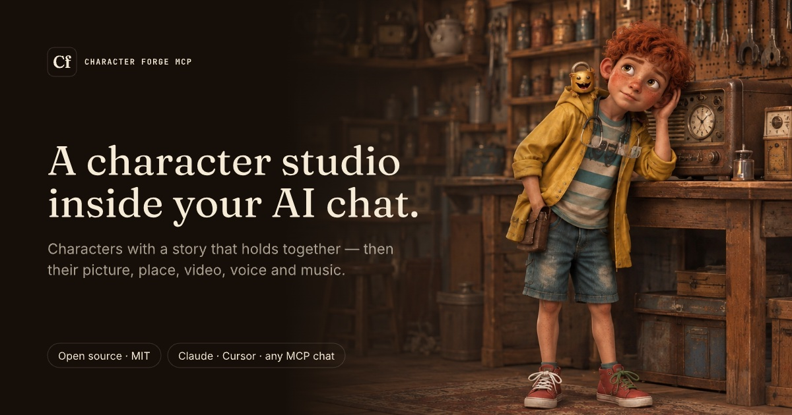
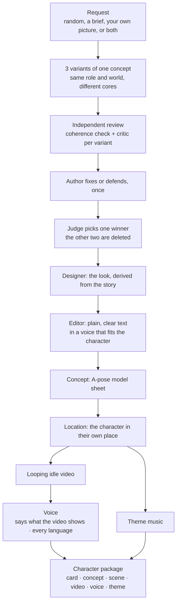

# character-forge-mcp

[](https://characters.gdhub.io)

[](https://github.com/gdhub-io/character-forge-mcp/actions/workflows/ci.yml)
[](https://www.npmjs.com/package/@gdhub/character-forge-mcp)
[](LICENSE)

**[characters.gdhub.io](https://characters.gdhub.io)** · An open-source [MCP](https://modelcontextprotocol.io) server for creating vivid, story-ready characters for film, games, animation, advertising, books and comics.

Connect it to any MCP-capable chat (Claude Code, Claude Desktop, Cursor and others) and ask for a character: at random, from a description, from your own picture, or from a picture and a description. You get a **character package**:

- **Character card**: goals, audience identification, psychological profile, description, fears, archetype and quirks, backstory and world, traits, and the character arc. It is saved as `card.json` and a readable `card.md`.
- **Look derived from the story**: shape language, silhouette, how perfect or flawed they are, a signature item (their attribute), marks with origins, movement, outfit and palette with meanings. An independent designer derives it from the finished story and cuts anything that doesn't show a part of it.
- **A-pose concept sheet**: a front/back model sheet, ready to hand to a 3D or animation artist (`assets/concept.png`).
- **On request, one step at a time**: the character in their own place (`scene.png`), an 8-second looping video of that place (`idle.mp4`), their voice saying a few lines about that moment in every language you need, a short theme of their own (`theme.mp3`), and the card translated into other languages.

Cards and prompts are free. Pictures, video, voice and music are generated on [fal.ai](https://fal.ai) with your own key, about $1.50 for a whole character.

**Random does not mean a pile of random traits.** Every character grows from one *core*: a **wound** teaches them a **lie**. The lie breeds a **fear**, which they protect with a **defense** (their worst trait). The same wound forged a **gift** (their best trait). Their arc is learning the **truth**. Each roll picks one curated, coherent core, then adds surprising *sparks* (occupation, world, archetype, visible mark) that the model has to make serve the core. You can't predict who you will get, but every part of the card hangs together.

### How a character is made



The winner gets its concept as part of the tournament. Everything after it is generated **only on request**, one step at a time, and every step is built from the card: the location from the character's key places and idle pose, the voice from their history and speech, the theme from their wound and dramatic question. The video comes after the location, and the voice after the video, because the voice is their inner monologue, the thoughts in their head in the moment the video shows; the music only needs the location.

**Already have a concept?** Give a brief and the image. What the picture shows (build, face, outfit, items, palette) becomes part of the brief, every variant's story explains it, the designer describes exactly that look, and the image becomes the winner's concept instead of a new one being generated. It's the same `character_create` call, with `concept` set.

### The variant tournament

By default every request produces **3 variants of the same concept**. If you ask for a fisherman, all three are fishermen in the same world, but different people with different cores. Then they compete:

1. **Author** writes all three as full cards.
2. **Coherence reviewer** (an independent agent per variant) checks that everything traces back to the core.
3. **Critic** (an independent agent per variant) argues why the variant should *not* ship, quoting the card and scoring it against a rubric.
4. **Author** fixes or rebuts each critique, once.
5. **Judge** compares the revised variants and picks one winner.

6. **Designer** (an independent agent) derives the winner's look from its story.
7. **Editor** (an independent agent) rewrites the winner's text so a stranger understands every field on the first read.

Only the winner is kept and gets an A-pose concept. The variants are written as drafts; when the judge has picked, `character_pick` moves the winner into the library and deletes the other two.

### Generation prompts (on request)

Ask for a prompt and you get exactly that one, written from the card:

- **concept**: an A-pose model sheet
- **illustration**: a key-art scene from the character's story, in a location and with an event happening
- **voice**: a voice-design description and an audition script for TTS voice-design tools
- **video**: a 5–10 s Seedance-style clip that shows the character in action
- **song**: a Suno style line and lyrics that tell the character's arc
- **theme**: an instrumental leitmotif (about 30 s, loops) built from the wound, the paradox and the dramatic question, as an ElevenLabs Music composition plan

Prompts are saved to `<character>/prompts/<kind>.md`. Writing a prompt never calls a generator; the concept, scene, video, voice and theme tools do, each only when asked.

A character can start from:

- **Nothing**: optionally fix the role ("a fisherman"), medium or genre. Everything else is rolled.
- **A brief**: you describe what matters ("a 60-year-old ex-boxer for a coffee ad, warm but stubborn"). Every variant keeps all of it and invents the rest.
- **Your own picture**, with or without a brief: every variant looks exactly like it, and its story explains what it shows.

Characters are always written in English; the card can then be translated.

## The method

For diagrams of how a character is built (the core chain, what shapes them, their path, how the audience gets to know them, and the tournament), see [docs/character-anatomy.md](docs/character-anatomy.md).

The card opens with the **core** (wound, lie, truth, central paradox, dramatic question) and then follows a 9-section character-development method inspired by Sherri Sheridan's *Developing Digital Short Films* and Michael Dougan's "one best / one worst / three other traits" formula (see [Credits](#credits)):

1. **Goals**: *want* (external, can change) vs. *need* (inner, carries the theme), motivation, goals that exclude each other, and the goal's climax
2. **Identification**: why the audience bonds with the character: flaws, a superpower balanced by a vulnerability, a sympathy hook…
3. **Psychology**: passive / reactive / active states, 3 lines of inner monologue, insecurity, triggers, childhood, and a device for showing the inner state on screen
4. **Description**: a name with meaning, the character's look, 3 formative life events, speech, sociology, dreams
5. **Fears**: conscious and unconscious fears, the mask, and how the character overcomes them
6. **Universal + unique**: an archetype with a twist and at least 5 filmable quirks
7. **Backstory & world**: who rules the world, what is worth dying for, plus secondary characters who reveal the hero's contradictions
8. **Traits**: energy, temperament, one best trait, one worst trait, three others, and typical reactions
9. **Destiny**: the void in the ordinary world, the threshold, the ordeal, the transformation

The schema checks that the card is complete: at least 3 identification methods, exactly 3 inner-monologue lines, exactly 3 life events, at least 5 quirks, and so on. When the model leaves something out, the server returns the exact field paths to fix.

## Install

Requires Node.js 20+. Nothing to clone or build: the server is published on npm.

### Claude Code (plugin, recommended)

The plugin bundles the MCP server, the skills (`forge-character`, `design-look`, `concept-art`, `character-prompts`, `translate-character`) and the agents (`character-coherence`, `character-critic`, `character-judge`, `character-designer`, `character-editor`). With the plugin, each reviewer runs as a separate agent with fresh context.

```
/plugin marketplace add gdhub-io/character-forge-mcp
/plugin install character-forge@character-forge
```

Claude Code asks for the optional fal.ai key when you install the plugin and keeps it in your system's secure storage. Leave it empty to make characters, cards and prompts only; add it later in `/plugin`.

### Claude Code (MCP only)

```bash
claude mcp add character-forge -e CHARACTER_FORGE_DIR=~/character-forge -e FAL_KEY=... -- npx -y @gdhub/character-forge-mcp
```

Without the plugin there are no separate reviewer agents. The model plays each role in a separate pass instead, which is weaker but still works.

### Claude Desktop / Cursor / any MCP client

```json
{
  "mcpServers": {
    "character-forge": {
      "command": "npx",
      "args": ["-y", "@gdhub/character-forge-mcp"],
      "env": {
        "CHARACTER_FORGE_DIR": "/Users/you/character-forge",
        "FAL_KEY": "..."
      }
    }
  }
}
```

Characters are saved to `CHARACTER_FORGE_DIR` (default `~/character-forge`), one folder per character. After connecting, restart the client (or `/mcp` → reconnect in Claude Code) and ask: *"Make me a random character for a noir film."*

| Environment variable | What it does |
|---|---|
| `FAL_KEY` | fal.ai key for pictures, video, voice and music. Optional: without it you get cards and ready prompts only |
| `CHARACTER_FORGE_DIR` | Where characters are saved (default `~/character-forge`) |
| `CHARACTER_FORGE_MODELS` | Path to your own `models.json`, to switch models or prices (see [Models and prices](#models-and-prices)) |

Video and audio steps also need [`ffmpeg`](https://ffmpeg.org) on your `PATH` (it joins the video into a loop and levels the sound).

## Use

In the chat:

> Make me a random character for a noir film.

> Character from a brief: a teenage beekeeper in a cyberpunk megacity, the hero of a cozy mobile game. She must be left-handed and afraid of crowds.

Clients that support MCP prompts also list `random_character` and `character_from_brief`.

### Tools

You talk to the chat; it calls these tools. Paid ones run only when you ask for that step.

| Tool | What it does | Cost |
|---|---|---|
| `character_create` | Starts a character from nothing, a brief, a concept image, or both: rolls 3 competing variants of one concept (coherent cores plus sparks) and says how to use the brief and the image | free |
| `character_method` | The method, the card rules and the tournament protocol | free |
| `character_role` | Instructions and rubric for a role: `coherence`, `critic`, `judge`, `author`, `designer`, `editor` | free |
| `character_check` | Coherence check: red flags (generic filler, repeats, want = need) plus questions built from the card's own content | free |
| `character_save` | Validates the full card and saves JSON + Markdown; returns the `id` | free |
| `character_pick` | Keeps the tournament winner and deletes the other variants; a picture the user gave becomes its concept | free |
| `character_concept` | The A-pose concept sheet | ≈ $0.02 |
| `character_scene` | The character in their own place, in their idle pose | ≈ $0.05 |
| `character_video` | An 8-second looping video of the scene | ≈ $0.67 |
| `character_voice` | Designs their voice and records a short monologue about the moment the video shows, in every language asked for | ≈ $0.03 a language |
| `character_voice_translation` / `character_voice_line` | The monologue in one more language / any single line in that voice | ≈ $0.03 |
| `character_theme` | A short theme of their own | ≈ $0.60 |
| `character_prompt` / `character_prompt_save` | Rules and card material for one generation prompt (`concept`, `illustration`, `voice`, `video`, `song`, `theme`) to use in any generator; saved as `prompts/<kind>.md` | free |
| `character_translate` | Saves the card in another language (checked against the original) | free |
| `character_next` | What can be made next for a character, with prices | free |
| `character_costs` | What a character has cost so far | free |
| `character_list` / `character_get` | List saved characters / return a card as Markdown or JSON | free |

## Media

Every media step is built from the card and saved in the character's folder: generated files in `assets/`, the prompt behind each one in `prompts/`, and what it cost in `costs.json`.

- **Concept sheet** (`character_concept`): character-forge draws a faceless A-pose figure from the card's `look.body` (the character's own proportions and asymmetries, front and back) and gives it to GPT Image as the pose reference, with the full description of the look. Options: `style` (`card` for the designer's suggestion, or any style text; saved as `concept-<style>.png`), `pose_image` (put the character in the pose of any picture → `concept-pose.png`), `seed`, `dry_run` (prompt only). `mode` switches to the older pipelines (Z-Image image-to-image or ControlNet), kept for experiments. Without `FAL_KEY` you get a ready prompt.
- **Location** (`character_scene`): the concept placed in a key location from the card, in the character's idle pose. It is the first frame of the video.
- **Idle video** (`character_video`): 8 seconds by default. Kling (silent) or Veo (optional sound); the end is crossfaded into the start so it loops without a seam.
- **Voice** (`character_voice`): a voice designed from the card (ElevenLabs for adults, Qwen for children), saying a few lines about the moment the video shows. Every language is a fresh performance from a translated script, not a dub.
- **Theme** (`character_theme`): about 30 seconds of instrumental music from the wound, the paradox and the dramatic question. Needs only the location.

### Models and prices

The provider (fal.ai) and the model for each kind of media live in [`models.json`](models.json), together with the prices used for the cost ledger. It is read on every call, so switching a model needs no rebuild or restart. To use your own, point `CHARACTER_FORGE_MODELS` at a copy.

## CLI

The same package is also a command-line tool, for scripts and quick tests. With no arguments it starts the MCP server on stdio.

```bash
npx @gdhub/character-forge-mcp roll --variants 3 --anchor fisherman    # roll 3 variants of one concept
npx @gdhub/character-forge-mcp check card.json                         # red flags + coherence questions
npx @gdhub/character-forge-mcp save card.json                          # validate and save to the library
npx @gdhub/character-forge-mcp next marta-vell                         # what can be made next, with prices
npx @gdhub/character-forge-mcp concept marta-vell                      # concept sheet (needs FAL_KEY)
npx @gdhub/character-forge-mcp costs marta-vell                        # what it has cost so far
npx @gdhub/character-forge-mcp list
npx @gdhub/character-forge-mcp --help                                  # every command
```

## Development

Want to help? Read [CONTRIBUTING.md](CONTRIBUTING.md): every change goes through a pull request, and releases are automatic.

### Set up

```bash
git clone https://github.com/gdhub-io/character-forge-mcp.git && cd character-forge-mcp
npm install
npm test           # builds dist/, then unit tests + an end-to-end MCP client/server test
npm run lint       # Biome; npm run format fixes what it can
```

For paid steps, put `FAL_KEY=...` in a `.env` file in the repo (it is gitignored). Tests never call paid APIs.

### Run your local build

- **Claude Code in this repo** picks up the local server from [`.mcp.json`](.mcp.json) (`node dist/index.js`) and saves characters to `./characters` (gitignored). The skills and agents in `skills/` and `agents/` are linked into `.claude/`, so they load too. Run `npm run build` after every change, then `/mcp` → reconnect. Don't install the plugin while working here, or everything loads twice.
- **Any other client**: point it at your build instead of npm:

  ```bash
  claude mcp add character-forge-dev -e CHARACTER_FORGE_DIR=~/character-forge -- node /abs/path/to/character-forge-mcp/dist/index.js
  ```

- **MCP Inspector**: `npm run inspect` opens the server in a browser to call tools by hand.

### The showcase site

`site/` is the website at [characters.gdhub.io](https://characters.gdhub.io) (Vite, React, Tailwind). Every push to `main` that touches `site/` builds it and publishes it on GitHub Pages.

```bash
cd site && npm install
npm run dev        # starts Vite on http://localhost:5173
```

The characters it shows are listed in `site/src/showcase.json`; their media live in `site/public/characters/` and are committed. `npm run dev` and `npm run build` refresh them from your local library (`../characters`) when it exists, and use the committed copies when it doesn't. `SITE_URL` (set in the Pages workflow) fills canonical links, the share image, the sitemap and `llms.txt`.

### Project layout

- `src/engine.ts`: curated core chains (wound → lie → fear → defense/gift → truth), occupations, visible marks. PRs that extend these are welcome.
- `src/methodology.ts`: the method as data (arc goals, flaws, fears, archetypes, trait lists…)
- `src/random.ts`: seeded rolls and variant sets
- `src/schema.ts`: the card schema (zod); `src/render.ts`: Markdown card rendering; `src/check.ts`: coherence red flags and questions
- `src/tournament.ts`: rubric and role instructions (coherence, critic, judge, author, designer, editor)
- `src/media.ts`: rules and card material for generation prompts
- `src/concept.ts`, `src/pose.ts`: the concept pipeline and the A-pose figure; `src/scene.ts`: location and video; `src/voice.ts`; `src/theme.ts`
- `src/fal.ts`, `src/ffmpeg.ts`, `src/config.ts` (models.json), `src/costs.ts` (the ledger), `src/next.ts` (next steps)
- `src/store.ts`: the character library on disk
- `src/tools/`: one file per MCP tool; `src/prompts/`: MCP prompts; `src/server.ts`; `src/index.ts`: CLI and stdio entry
- `skills/` and `agents/`: the plugin's skills and reviewer agents; `.claude-plugin/`: the plugin manifest
- `site/`: the showcase website; `design/`: its Pencil design
- `examples/`: complete reference cards; `docs/character-anatomy.md`: diagrams of the method

## Generated media

character-forge writes prompts and sends them to the models named in `models.json` (on fal.ai, with your own key); it saves whatever they return. The MIT license covers this tool, not what the models generate. Images, video, voices and music are subject to the terms of fal.ai and of each model's provider (for example OpenAI, Kling, Google, ElevenLabs, Qwen): what you may do with the results, commercial use included, and the rules about real people's likeness and voices. Check those terms before you use generated media in a product.

## Credits

The character method is inspired by Sherri Sheridan's book *Developing Digital Short Films* (its chapter on character) and Michael Dougan's "one best / one worst / three other traits" formula. The card's sections and reference lists follow the questions the book asks, retold in our own words and extended: the core chain (wound → lie → fear → defense / gift → truth), the variant tournament, the look derived from the story, and the media steps are this project's own. If the method works for you, read the book.

## License

[MIT](LICENSE), with one exception: the character **Fanya** (her name, story, card, look and the media in [`site/public/characters/fanya/`](site/public/characters/fanya/LICENSE.md)) is © Dzmitry Drynau, all rights reserved. She appears on the site as an example and may not be reused. The other example characters are under MIT like the rest of the code.
