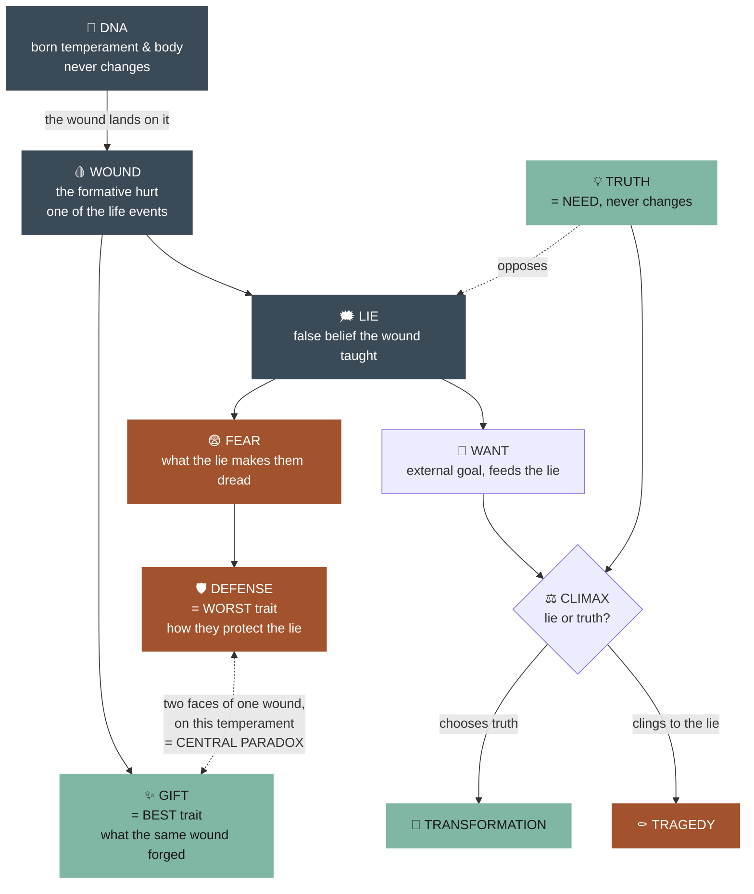
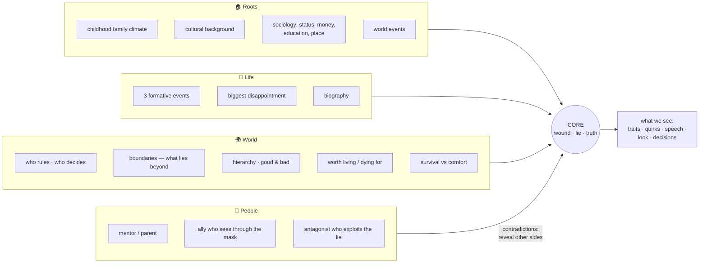
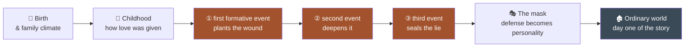
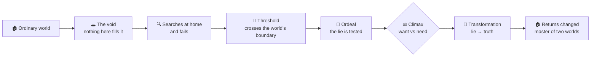
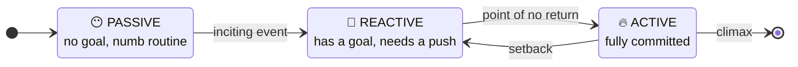
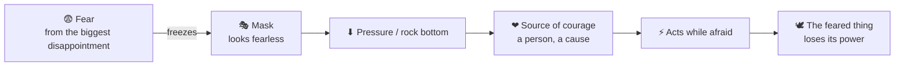
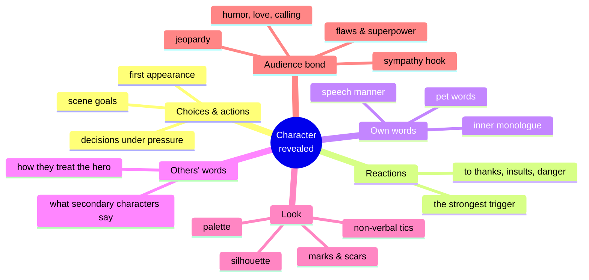
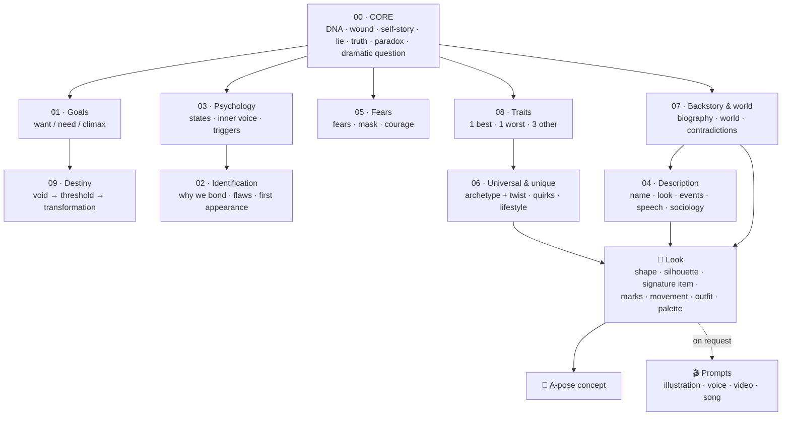
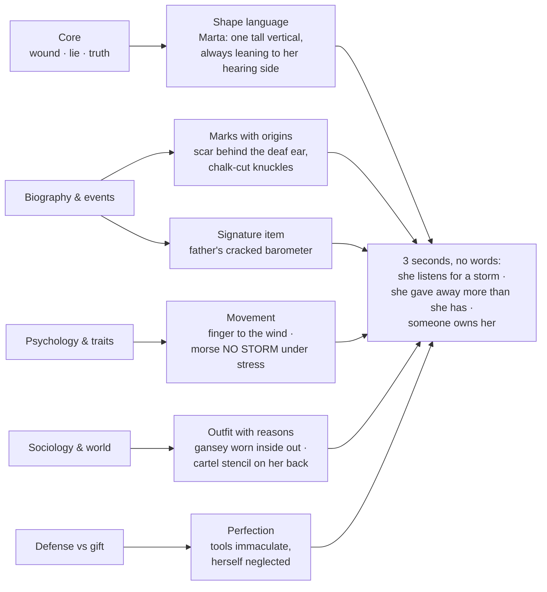
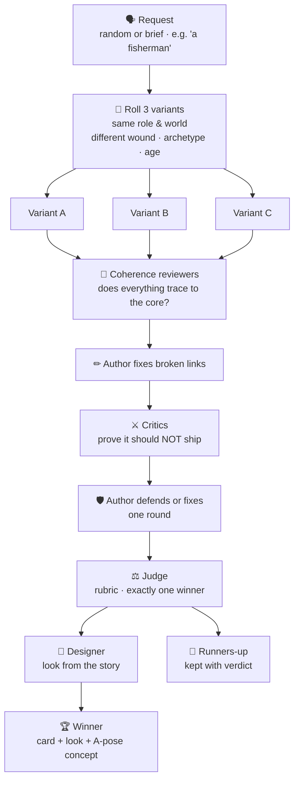

# Anatomy of a character

How character-forge builds a character: what shapes them, the path that made them who they are, how the story changes them, and how the audience gets to know them.

The running example is **Marta Vell** ([examples/marta-vell.json](../examples/marta-vell.json)), a storm-reader who heard the flood coming and sold her silence.

---

## 1. The core: one causal chain

A strong character is one system, not a list of traits. They are born with a **DNA** (a temperament of six scales and an innate body) that never changes, and everything else grows from a single **wound** that lands on it. The same wound turns inward in a withdrawn, sensitive child and into bravado in an outgoing, thick-skinned one.

| Link | Marta Vell |
|---|---|
| Wound | Her father dismissed her forecasts. At 26 she heard the flood coming three days out and sold her silence |
| Lie | "I am only worth what my gift is worth to someone, and I've already proved what I'm worth" |
| Fear | Being exposed; being loved for herself *(unconscious)* |
| Defense → worst trait | Self-destructive: she carries a safety line and never clips on |
| Gift → best trait | Survivor: no one alive reads a storm better |
| Central paradox | The best storm-reader alive is the reason a town drowned unwarned |
| Want | Get the drowned town's bell back from the man who bought her silence |
| Need = truth | "I am worth saving even when I have nothing left to give" |
| Climax | Chalk CALM (call a girl's true forecast a lie, as her father did to her) and get the bell, or chalk WAVE, sign it and confess |

---|---|
| Wound | Loved by her father only when useful; then she sold that usefulness, and her silenced horn drowned the town |
| Lie | "I am only worth what I can do — and I've already done the unforgivable" |
| Fear | Being caught for what she did; being loved for herself *(unconscious)* |
| Defense → worst trait | Self-destructive: she takes reef runs without a safety line |
| Gift → best trait | Survivor: no one reads a storm better |
| Central paradox | The survivor who wants to drown |
| Want | Buy back the town's bell |
| Need = truth | "I am worth saving even when I have nothing left to give" |
| Climax | Ring the bell to save the man who bought her silence? |

---

## 2. What shapes them

Outside forces press on the core. Each one should either feed the wound or put pressure on the lie. Anything that does neither is decoration.

---

## 3. The path that made them who they are

From birth to the first page of the story. The **biography** tells this path as prose; the card breaks it into its parts.

Marta's path:
- Raised as her father's apprentice rather than his daughter.
- **At 9:** blamed for a storm she predicted.
- **At 26:** hears the flood coming, signs Hale's receipt and tells her father "no storm". The town drowns, and the horn she sounds too late deafens her.
- **At 30:** walks into the sea, and a raft girl, Pell, drags her back.
- Today: she scrapes hulls for food and chalks the forecast free every dawn.

---

## 4. The path the story takes them on

The destiny arc. In the ordinary world there is a **void** that nothing there can fill. They have to cross the boundary of their world to fill it.

Along the way the character moves through three psychological states:

Fear works against this movement. The more they fear, the less they act. Courage is acting in spite of fear. The story has to show what pushes them through.

---

## 5. How the audience gets to know them

Character is never stated. It is revealed.

---

## 6. The card at a glance

How the card's sections relate to each other. The core feeds everything else.

---

## 7. The look grows out of the story

The designer gets the finished story and derives the look from it. Every element has to answer the question "which part of the story does this show?" Anything that can't answer is cut.

Rules of restraint:
- 1–2 strong symbols carry the look; don't repeat a motif across many fields.
- Leave one detail that raises a question instead of answering it. Marta's jersey is inside out, and only the ending reveals why.

---

## 8. How character-forge produces one

The variant tournament: three versions of the same concept compete, and only the strongest ships.

Judge's rubric, out of 100:

| Criterion | Points |
|---|---|
| Coherence: everything traces back to the core | 20 |
| Conflict: want vs need forces an impossible choice | 20 |
| Specificity: concrete, filmable, not swappable into another story | 15 |
| Playability: generates scenes, the character is active | 15 |
| Fit: matches the brief, role and medium | 10 |
| Visual: readable silhouette that tells the story | 10 |
| Voice: recognisable with the name removed | 10 |
