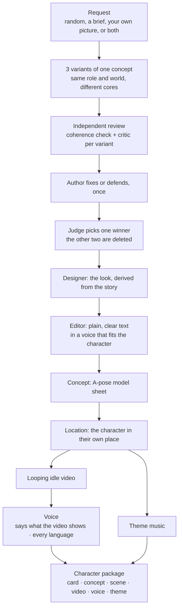

# Reference

Everything the README leaves out: how the tournament runs, the method behind the card, every tool, the media pipeline, models and prices, the command line and settings. For contributing, see [CONTRIBUTING.md](../CONTRIBUTING.md).

## How a character is made



The winner gets its concept as part of the tournament. Everything after it is generated **only on request**, one step at a time, and every step is built from the card: the location from the character's key places and idle pose, the voice from their history and speech, the theme from their wound and dramatic question. The video comes after the location, and the voice after the video, because the voice is their inner monologue, the thoughts in their head in the moment the video shows; the music only needs the location.

**Already have a concept?** Give a brief and the image. What the picture shows (build, face, outfit, items, palette) becomes part of the brief, every variant's story explains it, the designer describes exactly that look, and the image becomes the winner's concept instead of a new one being generated. It's the same `character_create` call, with `concept` set.

## The variant tournament

By default every request produces **3 variants of the same concept**. If you ask for a fisherman, all three are fishermen in the same world, but different people with different cores. Then they compete:

1. **Author** writes all three as full cards.
2. **Coherence reviewer** (an independent agent per variant) checks that everything traces back to the core.
3. **Critic** (an independent agent per variant) argues why the variant should *not* ship, quoting the card and scoring it against a rubric.
4. **Author** fixes or rebuts each critique, once.
5. **Judge** compares the revised variants and picks one winner.

6. **Designer** (an independent agent) derives the winner's look from its story.
7. **Editor** (an independent agent) rewrites the winner's text so a stranger understands every field on the first read.

Only the winner is kept and gets an A-pose concept. The variants are written as drafts; when the judge has picked, `character_pick` moves the winner into the library and deletes the other two.

## The method

For diagrams of how a character is built (the core chain, what shapes them, their path, how the audience gets to know them, and the tournament), see [character-anatomy.md](character-anatomy.md).

The card opens with the **core** (wound, lie, truth, central paradox, dramatic question) and then follows a 9-section character-development method inspired by Sherri Sheridan's *Developing Digital Short Films* and Michael Dougan's "one best / one worst / three other traits" formula (see [License and credits](../README.md#license-and-credits)):

1. **Goals**: *want* (external, can change) vs. *need* (inner, carries the theme), motivation, goals that exclude each other, and the goal's climax
2. **Identification**: why the audience bonds with the character: flaws, a superpower balanced by a vulnerability, a sympathy hook…
3. **Psychology**: passive / reactive / active states, 3 lines of inner monologue, insecurity, triggers, childhood, and a device for showing the inner state on screen
4. **Description**: a name with meaning, the character's look, 3 formative life events, speech, sociology, dreams
5. **Fears**: conscious and unconscious fears, the mask, and how the character overcomes them
6. **Universal + unique**: an archetype with a twist and at least 5 filmable quirks
7. **Backstory & world**: who rules the world, what is worth dying for, plus secondary characters who reveal the hero's contradictions
8. **Traits**: energy, temperament, one best trait, one worst trait, three others, and typical reactions
9. **Destiny**: the void in the ordinary world, the threshold, the ordeal, the transformation

The schema checks that the card is complete: at least 3 identification methods, exactly 3 inner-monologue lines, exactly 3 life events, at least 5 quirks, and so on. When the model leaves something out, the server returns the exact field paths to fix.

## Tools

You talk to the chat; it calls these tools. Paid ones run only when you ask for that step.

| Tool | What it does | Cost |
|---|---|---|
| `character_create` | Starts a character from nothing, a brief, a concept image, or both: rolls 3 competing variants of one concept (coherent cores plus sparks) and says how to use the brief and the image | free |
| `character_method` | The method, the card rules and the tournament protocol | free |
| `character_role` | Instructions and rubric for a role: `coherence`, `critic`, `judge`, `author`, `designer`, `editor` | free |
| `character_check` | Coherence check: red flags (generic filler, repeats, want = need) plus questions built from the card's own content | free |
| `character_save` | Validates the full card and saves JSON + Markdown; returns the `id` | free |
| `character_pick` | Keeps the tournament winner and deletes the other variants; a picture the user gave becomes its concept | free |
| `character_concept` | The A-pose concept sheet | ≈ $0.02 |
| `character_scene` | The character in their own place, in their idle pose | ≈ $0.05 |
| `character_video` | An 8-second looping video of the scene | ≈ $0.67 |
| `character_voice` | Designs their voice and records a short monologue about the moment the video shows, in every language asked for | ≈ $0.03 a language |
| `character_voice_translation` / `character_voice_line` | The monologue in one more language / any single line in that voice | ≈ $0.03 |
| `character_theme` | A short theme of their own | ≈ $0.60 |
| `character_prompt` / `character_prompt_save` | Rules and card material for one generation prompt (`concept`, `illustration`, `voice`, `video`, `song`, `theme`) to use in any generator; saved as `prompts/<kind>.md` | free |
| `character_translate` | Saves the card in another language (checked against the original) | free |
| `character_next` | What can be made next for a character, with prices | free |
| `character_costs` | What a character has cost so far | free |
| `character_list` / `character_get` | List saved characters / show a card as a Markdown document (or JSON to edit) | free |

Every saved card is also an MCP resource, `character-forge://<id>/card.md`, so apps with a resource picker can open or attach it.

## Generation prompts (on request)

Ask for a prompt and you get exactly that one, written from the card:

- **concept**: an A-pose model sheet
- **illustration**: a key-art scene from the character's story, in a location and with an event happening
- **voice**: a voice-design description and an audition script for TTS voice-design tools
- **video**: a 5–10 s Seedance-style clip that shows the character in action
- **song**: a Suno style line and lyrics that tell the character's arc
- **theme**: an instrumental leitmotif (about 30 s, loops) built from the wound, the paradox and the dramatic question, as an ElevenLabs Music composition plan

Prompts are saved to `<character>/prompts/<kind>.md`. Writing a prompt never calls a generator; the concept, scene, video, voice and theme tools do, each only when asked.

## Media

Every media step is built from the card and saved in the character's folder: generated files in `assets/`, the prompt behind each one in `prompts/`, and what it cost in `costs.json`.

- **Concept sheet** (`character_concept`): character-forge draws a faceless A-pose figure from the card's `look.body` (the character's own proportions and asymmetries, front and back) and gives it to GPT Image as the pose reference, with the full description of the look. Options: `style` (`card` for the designer's suggestion, or any style text; saved as `concept-<style>.png`), `pose_image` (put the character in the pose of any picture → `concept-pose.png`), `seed`, `dry_run` (prompt only). `mode` switches to the older pipelines (Z-Image image-to-image or ControlNet), kept for experiments. Without `FAL_KEY` you get a ready prompt.
- **Location** (`character_scene`): the concept placed in a key location from the card, in the character's idle pose. It is the first frame of the video.
- **Idle video** (`character_video`): 8 seconds by default. Kling (silent) or Veo (optional sound); the end is crossfaded into the start so it loops without a seam.
- **Voice** (`character_voice`): a voice designed from the card (ElevenLabs for adults, Qwen for children), saying a few lines about the moment the video shows. Every language is a fresh performance from a translated script, not a dub.
- **Theme** (`character_theme`): about 30 seconds of instrumental music from the wound, the paradox and the dramatic question. Needs only the location.

### Models and prices

The provider (fal.ai) and the model for each kind of media live in [`models.json`](../models.json), together with the prices used for the cost ledger. It is read on every call, so switching a model needs no rebuild or restart. To use your own, point `CHARACTER_FORGE_MODELS` at a copy.

## CLI

The same package is also a command-line tool, for scripts and quick tests. With no arguments it starts the MCP server on stdio.

```bash
npx @gdhub/character-forge-mcp roll --variants 3 --anchor fisherman    # roll 3 variants of one concept
npx @gdhub/character-forge-mcp check card.json                         # red flags + coherence questions
npx @gdhub/character-forge-mcp save card.json                          # validate and save to the library
npx @gdhub/character-forge-mcp next marta-vell                         # what can be made next, with prices
npx @gdhub/character-forge-mcp concept marta-vell                      # concept sheet (needs FAL_KEY)
npx @gdhub/character-forge-mcp costs marta-vell                        # what it has cost so far
npx @gdhub/character-forge-mcp list
npx @gdhub/character-forge-mcp --help                                  # every command
```

## Settings

| Environment variable | What it does |
|---|---|
| `FAL_KEY` | fal.ai key for pictures, video, voice and music. Optional: without it you get cards and ready prompts |
| `CHARACTER_FORGE_DIR` | Where characters are saved (default `~/character-forge`) |
| `CHARACTER_FORGE_MODELS` | Path to your own `models.json`, to switch models or prices |

A `.env` file in the folder the server starts from is read too.
